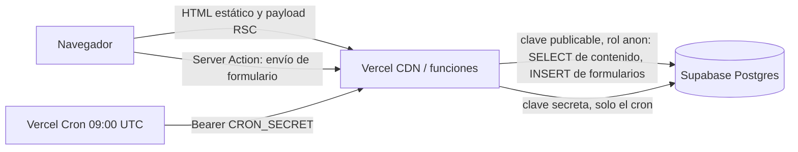
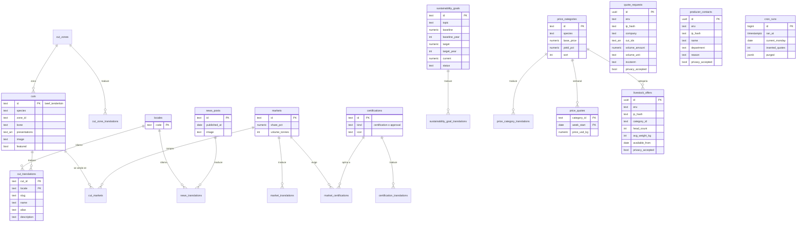
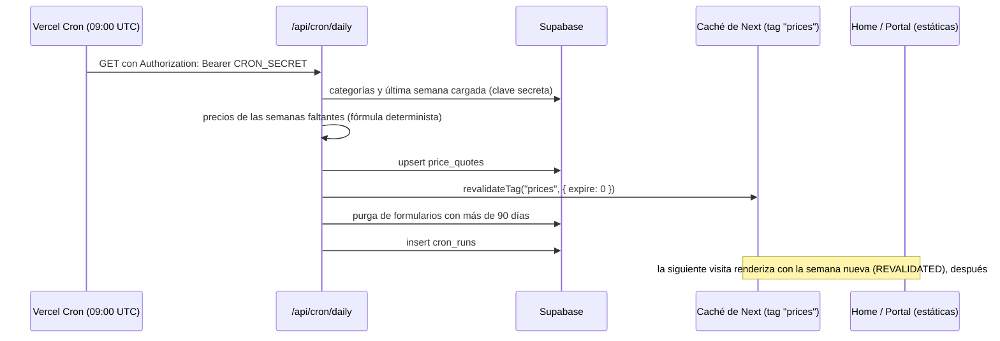
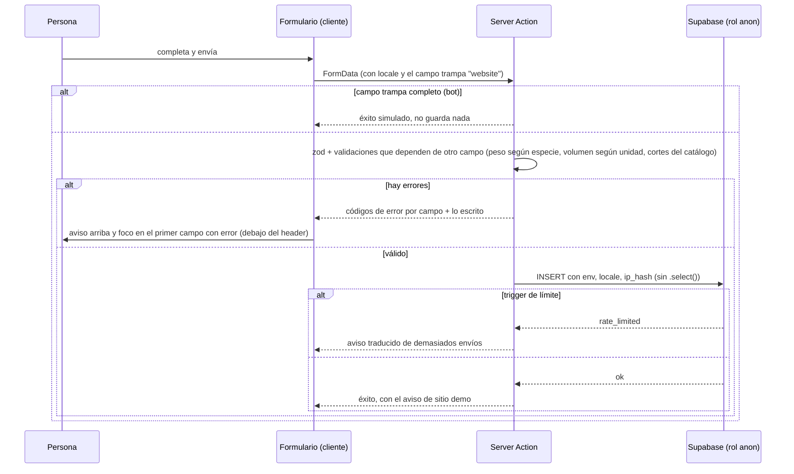

# Arquitectura

Cómo está armado el sitio de Frigorífico Cuchilla Grande. Para correrlo, ver el [README](README.md);
para las convenciones de trabajo, [CLAUDE.md](CLAUDE.md); para los resultados de calidad,
[docs/QA.md](docs/QA.md).

## Panorama

- **Next.js 16** (App Router) con **Cache Components**: las páginas son estáticas (prerender) y los
  datos de la base se leen con `'use cache'`, cacheados por días e invalidados por etiqueta.
- **Supabase** (Postgres) como base de contenido y de formularios. El navegador **nunca** habla con
  Supabase: todo pasa por Server Components y Server Actions.
- **next-intl** para dos idiomas con rutas, slugs y contenido traducidos.
- **Vercel Hobby** con un único cron diario (keep-alive de la base, rotación de precios, purga).



## Estructura de carpetas

```
src/
  app/
    [locale]/                 todas las páginas (el idioma es un root param)
      layout.tsx              <html lang>, fuentes, proveedor de next-intl, JSON-LD Organization
      page.tsx                home
      products/               catálogo y detalle /products/[species]/[cut]
      markets/ quality/ company/ producers/ contact/ news/ sustainability/ careers/ privacy/
      error.tsx not-found.tsx [...rest]/   errores y 404 localizados
      **/opengraph-image.tsx, twitter-image.tsx   imágenes para redes (next/og)
    api/cron/daily/route.ts   único cron: precios, purga, keep-alive, registro
    global-error.tsx  robots.ts  sitemap.ts  manifest.ts  icon.svg
  components/
    ui/                       Button, Section, Container, Card, Badge, Tabs
    layout/                   header, footer, menú móvil (portal), selector de idioma
    home/ cuts/ markets/ producers/ contact/ news/ quality/ seo/ forms/
  config/navigation.ts        menú principal y barra superior
  data/company.ts             ÚNICA fuente de cifras y datos de la empresa
  i18n/                       routing (locales + rutas traducidas), request, navigation
  lib/
    data/                     lecturas cacheadas ('use cache'): catálogo, precios, mercados, noticias…
    prices/rotation.ts        fórmula determinista de la pizarra (la comparten seed y cron)
    forms/                    tipos, helpers de Server Actions (insert anon, honeypot, hash de IP), reglas
    markets/ location-geometry.ts   geometría de los mapas (server-only)
    og/                       plantillas de imágenes OG y fuentes estáticas
    supabase/                 public.ts (clave publicable) y admin.ts (clave secreta, server-only)
    format.ts metadata.ts site.ts contact.ts motion.ts
  messages/{es,en}.json       textos de interfaz
  proxy.ts                    middleware de next-intl (idioma y rutas traducidas)
supabase/
  migrations/                 SQL versionado, solo aditivo
  seed/                       contenido bilingüe en TypeScript (cortes, mercados, noticias…)
scripts/                      seed, pruebas de permisos, QA con Playwright, checks, Lighthouse, ops
docs/                         QA.md, capturas del README (img/) y del informe de QA (qa/)
```

## Modelo de datos

Contenido bilingüe con **tabla base + tabla `*_translations`** (una fila por idioma, FK a `locales`).
Sumar un idioma es agregar una fila en `locales` y sus traducciones, sin cambiar el esquema.



- **Ids neutros**: los cortes usan `${species}_${clave}` (`beef_tenderloin`), los mercados `cn`, `eu`… Los
  mismos ids viajan en la URL (`?market=cn`, `?cut=beef_tenderloin`) en los dos idiomas.
- **Vista `price_board`** (`security_invoker`): la semana vigente y la variación contra la anterior.
- **Formularios** (`quote_requests`, `producer_contacts`, `livestock_offers`): columna `env`
  (`development` / `preview` / `production`), `ip_hash` y `privacy_accepted` con check. Se purgan a
  los 90 días.
- **`cron_runs`**: una fila por ejecución del cron, porque los logs de Vercel Hobby no alcanzan para
  verificar que corrió todos los días (`npm run ops:status`).
- **Migraciones solo aditivas** sobre una única base para desarrollo y producción: orden migración →
  seed → deploy. Las columnas obligatorias nuevas se exigen con checks `NOT VALID` (aplican a filas
  nuevas sin revalidar las viejas).

## Internacionalización

- **Rutas traducidas** con `pathnames` de next-intl: las rutas internas están en inglés y cada idioma
  define la pública (`/products` → `/es/productos`, `/en/products`). El detalle de corte incluye la
  especie traducida (`/es/productos/vacuno/lomo` ↔ `/en/products/beef/tenderloin`).
- **Slugs de contenido traducidos**, derivados del nombre en el seed (`UNIQUE(locale, slug)`). Cada
  detalle declara sus rutas equivalentes (`<SetAlternates>`) para que el selector de idioma lleve a la
  misma pieza, y la metadata publica `hreflang` es/en/x-default con esos slugs.
- **El selector de idioma usa `<a>`, no `<Link>`**: el idioma es un root param con su propio
  `<html lang>`, y la navegación de cliente entre layouts raíz dejaba montadas las dos páginas.
- **Contenido**: interfaz en `messages/{es,en}.json`; datos (cortes, mercados, noticias, metas) en la
  base con tablas de traducción; cifras de la empresa en `company.ts` con campos `{ es, en }`.
- **Formatos**: toda cifra pasa por `formatFigure` (separador de miles siempre) y toda fecha por
  `formatDate` (inglés británico, "12 October 2026").
- **Checks**: `i18n:check` falla si falta una clave, si un texto está vacío o si el inglés es igual
  al español (salvo una lista de excepciones: nombres propios, siglas). ESLint prohíbe texto literal
  en JSX y en `alt`, `title`, `placeholder` y `aria-label`.

## Caché y cron

Las páginas son estáticas y los datos se leen con `'use cache'` + `cacheTag` + `cacheLife("days")`.
La pizarra de precios queda **dentro del HTML prerenderizado** (los datos cacheados no van dentro de
`<Suspense>`: React los movería al final del documento).



- **Fórmula de precios** (`lib/prices/rotation.ts`): el precio de una semana es función **solo** de la
  categoría y del lunes, así que el seed y el cron siempre coinciden y regenerar es idempotente.
  1. Índice de mercado por especie: paseo aleatorio con reversión a 1 desde 2025-01-06 (choque de
     ±2 % por semana derivado de un hash FNV-1a de la especie y la fecha, 15 % de reversión).
  2. Precio de la categoría = base × índice × (1 + ruido de ±0,5 % por categoría).
  3. Orden garantizado dentro de cada especie: cada categoría queda al menos US$ 0,05 por debajo de la
     anterior (novillo > vaquillona > vaca; cordero pesado > borrego > oveja).
- **Keep-alive**: Supabase gratuito pausa el proyecto tras 7 días sin actividad; las consultas
  diarias del cron lo mantienen activo.
- **Red de seguridad**: si el cron no corre, `cacheLife("days")` revalida la pizarra a las 24 horas.

## Seguridad

- **Claves**: la **publicable** (rol `anon`) se usa para todas las lecturas de contenido y todos los
  inserts de formularios; la **secreta** (`service_role`) solo en el endpoint del cron y en los
  scripts. Usar la secreta en la app anularía RLS y grants y dejaría sin valor la prueba de permisos.
  Ninguna variable de Supabase llega al navegador.
- **RLS en todas las tablas** y default privileges revocados. Contenido: `grant select` a anon.
  Formularios: `grant insert` **por columna** (sin `id` ni `created_at`, para que el límite no se
  pueda burlar), sin SELECT, UPDATE ni DELETE. Los inserts van sin `.select()` (devolver la fila
  requeriría SELECT). `cron_runs`: ningún permiso para anon.
- **Límite de envíos en la base**: un trigger `before insert` en las tres tablas de formularios
  rechaza más de 5 envíos por `ip_hash` en 10 minutos y más de 300 por tabla en una hora. La IP no se
  guarda: solo `sha256(IP + IP_HASH_SALT)`.
- **Checks en la base**: largos, formatos (email, teléfono), valores permitidos (incoterm, unidad,
  motivo) y `privacy_accepted`. `npm run db:test-permissions` los prueba con la clave publicable.
- **Headers**: CSP sin orígenes externos (`default-src 'self'`, `frame-ancestors 'none'`,
  `object-src 'none'`), `X-Content-Type-Options`, `Referrer-Policy`, `Permissions-Policy`,
  `X-Frame-Options: DENY`, COOP y HSTS. La CSP necesita `'unsafe-inline'` en scripts porque Next
  inyecta scripts inline en páginas estáticas; la alternativa con nonce obligaría a renderizar cada
  página en cada visita. Hay una variante estricta en report-only para auditar
  (`CSP_STRICT_REPORT_ONLY`).
- **Indexación**: con `SITE_INDEXABLE=false` (por defecto), noindex en meta, robots.txt y
  `X-Robots-Tag`.

## Formularios: el recorrido de un envío



- Los errores viajan como **códigos** (`required`, `range`, `email`…) con sus valores y se traducen en
  el cliente con `Forms.errors.*`: la acción no depende del idioma.
- Las validaciones que dependen de otro campo van **fuera del schema** de zod, porque zod no corre los
  refinamientos del objeto si otro campo ya falló, y el error tiene que verse junto con los demás.
- La base de formularios es reutilizable (`components/forms`): campos con label, ayuda y error unidos
  por `aria-describedby`, honeypot, botón con estado "Enviando…", avisos y manejo del foco. Dos
  formularios en la misma página usan prefijos de id distintos (`FieldIdScope`).

## Mapas: SVG generado en el servidor

- **Mercados**: `lib/markets/world-geometry.ts` convierte el TopoJSON de Natural Earth 1:110m
  (world-atlas) a GeoJSON con topojson-client, lo proyecta con `geoEqualEarth().fitWidth(960)` de
  d3-geo y genera los `d` de cada país con un decimal. El componente de servidor arma el SVG: países
  de destino con una escala de bordó según la participación, el resto en gris cálido y Uruguay como
  origen. Cada mercado es un `<g role="button" tabindex="0">` que agrupa sus países.
- **Interacción**: un componente de cliente chico (delegación de eventos, `data-active`,
  `aria-expanded`) muestra el panel del mercado, pasa el foco con Enter y lo devuelve con Escape. Los
  paneles se renderizan en el servidor.
- **Ubicación** (contacto): Uruguay y sus vecinos en 1:50m con Mercator, la planta y el puerto de
  Montevideo.
- Resultado: sin teselas, sin servicios externos, sin Leaflet, y **ni d3 ni los datos del mapa llegan
  al navegador** (verificado en el build).

## Estrategia de pruebas

Todas las pruebas son scripts de Playwright o Node que corren contra cualquier URL (local o
producción). Al cerrar cada fase se corrieron contra producción.

| Prueba | Qué cubre |
|---|---|
| `typecheck`, `lint` | TypeScript estricto; ESLint con reglas contra textos sin traducir |
| `i18n:check` | Paridad de mensajes y contenido entre idiomas, placeholders ICU |
| `db:test-permissions` | RLS, grants por columna, inserts sin SELECT, `created_at` forjado, checks, límite de envíos, funciones internas, `cron_runs` |
| `check:links` | Rastreo en anchura de todo el sitio: links, anclas entre páginas, soft-404, ningún mailto de cotización |
| `check:seo` | Las 106 URLs del sitemap: título y descripción únicos, canonical, hreflang recíproco, robots según el modo, OG/Twitter (estado y peso), JSON-LD, formato de fechas por idioma |
| `qa:layout` | Salto al contenido, menú móvil accesible, selector de idioma con filtros, imágenes, overflow a 375 px |
| `qa:catalog` | Diagrama por teclado, filtros en la URL, cambio de idioma con filtros, estado vacío, detalle, 404 |
| `qa:institutional` | Mapa igual a la lista, links al catálogo filtrado, panel por teclado, CLS, 375 px |
| `qa:producers` | Pizarra: orden y fórmula en 12 semanas; calculadora (cálculos, rangos por especie, formatos); precarga; validaciones; honeypot; límite; errores visibles a 375 px; envío real con borrado |
| `qa:contact` | Pestañas por teclado y por URL, precarga del corte desde el catálogo en ES y EN, búsqueda de cortes, validaciones, honeypot, envío real por formulario con borrado |
| `qa:fixes` | Regresiones de correcciones puntuales (menú a 375×667, catálogo móvil compacto, panel de filtros) |
| `qa:a11y` | axe en todos los tipos de página y estados, ES/EN, 1440/375 px; `lang`; zoom al 200 %; movimiento reducido |
| `qa:keyboard` | Tab por cada formulario, diagrama, mapa, pestañas y menú, con foco visible en cada parada |
| `lighthouse` | Lighthouse móvil de 6 páginas × ES/EN |
| `ops:status` | Ejecuciones del cron sin huecos, pizarra vigente, purga |

Los envíos reales en producción se identifican con una marca por corrida y se borran al final con la
clave secreta; el registro queda como JSON junto a las capturas.
