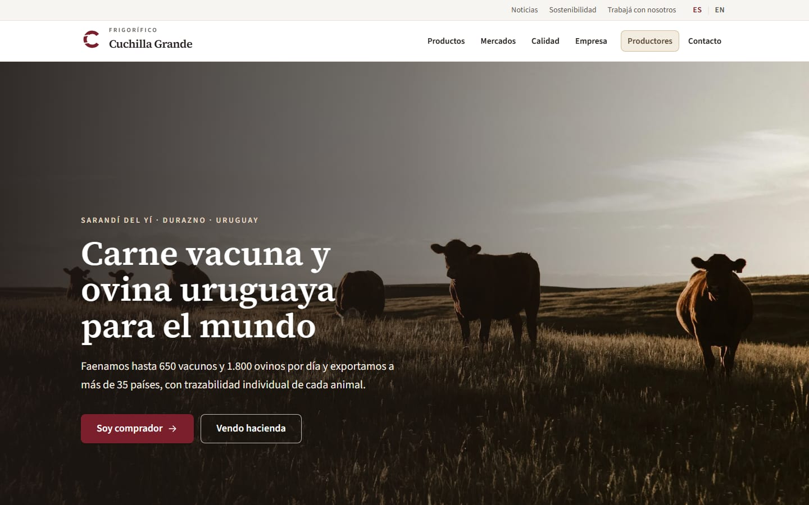
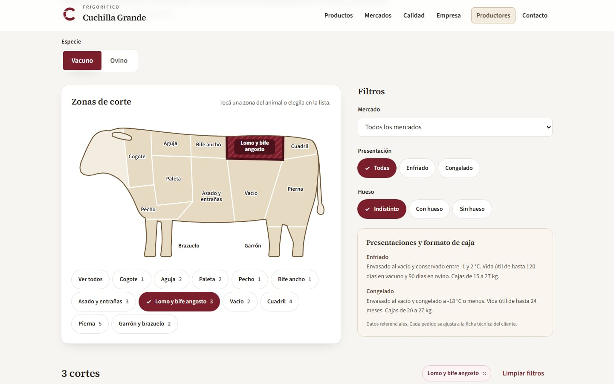
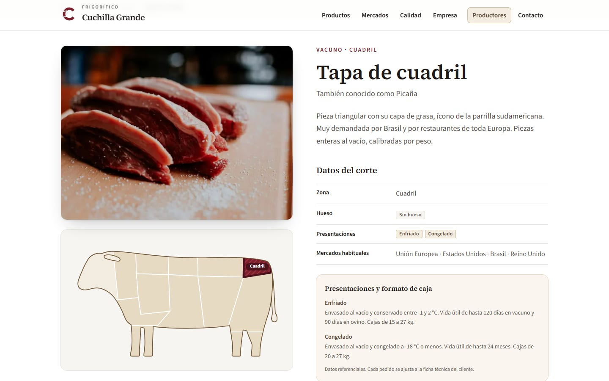
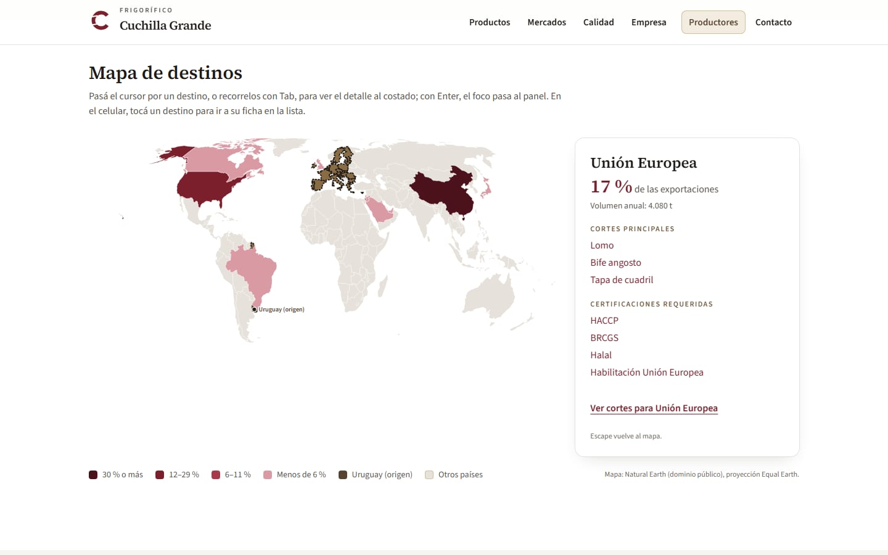
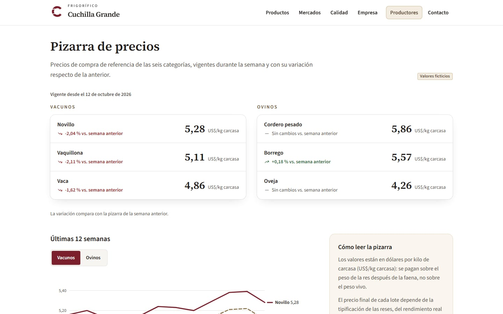
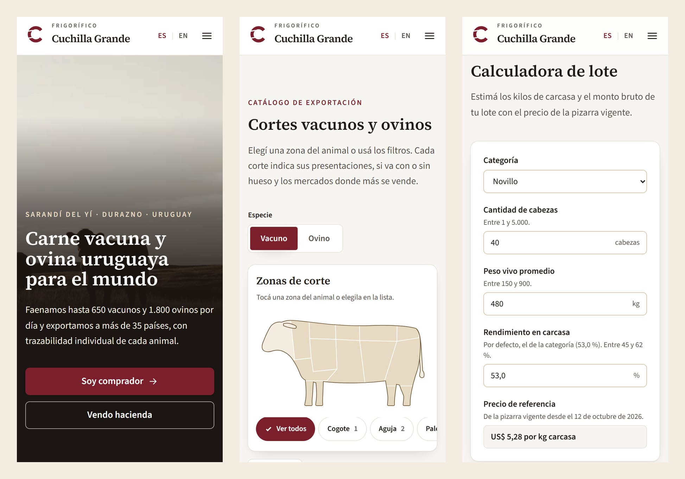

# Frigorífico Cuchilla Grande

**Español** · [English](#english)

Sitio web de un frigorífico uruguayo **ficticio**, exportador de carne vacuna y ovina. Es una demo de
portfolio de [fourvexa.com](https://fourvexa.com): la marca, las personas, las cifras, los precios y
las noticias son inventados, pero verosímiles.

**Producción:** https://frigorifico-cuchilla-grande.vercel.app

El sitio no se indexa en buscadores a propósito (`SITE_INDEXABLE=false`): no queremos que una empresa
inventada confunda a productores reales. Todo el SEO está implementado igual, para demostrarlo.



| Catálogo con diagrama | Detalle de corte |
|---|---|
|  |  |
| **Mapa de mercados** | **Portal de productores** |
|  |  |



## Funcionalidades destacadas

- **Diagrama de cortes interactivo.** Siluetas SVG propias de la res y el cordero, con cada zona como
  polígono de una partición del plano (sin huecos ni superposiciones). Se maneja con mouse, con el
  dedo y con el teclado (Tab, Enter, Espacio); el estado seleccionado no depende solo del color.
- **Catálogo filtrable con URLs compartibles.** 36 cortes (26 vacunos y 10 ovinos) con nombres del
  manual de INAC. Los filtros de especie, zona, mercado, presentación y hueso viven en la URL
  (`?species=lamb&zone=leg&market=cn`) con claves neutras, iguales en los dos idiomas. En el celular,
  los filtros van en un panel modal accesible.
- **Mapa de mercados en SVG propio.** Natural Earth y d3-geo, proyectado en el servidor: el cliente no
  descarga ni la librería ni los datos del mapa. Un elemento enfocable por mercado (la UE o Medio
  Oriente se resaltan completos) y un panel lateral con participación, cortes y certificaciones.
- **Pizarra semanal que rota sola.** Precios de referencia de hacienda generados con una fórmula
  determinista: un índice de mercado por especie más un ruido chico por categoría, con el orden
  garantizado (novillo > vaquillona > vaca). Un cron diario carga la semana nueva e invalida la caché:
  la home estática muestra los precios nuevos sin redeploy.
- **Calculadora de lote.** Cabezas × peso vivo × rendimiento × precio de la pizarra, con rangos por
  especie, formato numérico por idioma y "Ofrecer este lote", que precarga el formulario.
- **Formularios seguros.** Server Actions con zod, honeypot y límite de envíos aplicado en la base. El
  rol anónimo de Supabase solo puede insertar (ni leer ni editar), con grants por columna y RLS. Hay
  una prueba automática de permisos y los envíos se purgan a los 90 días.
- **Sitio bilingüe de verdad.** Español e inglés (británico) con rutas traducidas (`/es/productos` ↔
  `/en/products`), slugs de cortes y noticias traducidos, contenido de la base en los dos idiomas y
  un check que falla ante cualquier texto sin traducir.

## Stack

Next.js 16 (App Router, Cache Components, Turbopack) · React 19 · TypeScript · Tailwind CSS 4 ·
next-intl 4 · Supabase (Postgres, RLS) · zod · d3-geo + Natural Earth · Vercel (Hobby, con cron
diario) · Playwright, axe y Lighthouse para QA.

Detalle en [ARCHITECTURE.md](ARCHITECTURE.md). Cómo se construyó, fase por fase y con sus problemas
reales, en [PROCESS.md](PROCESS.md).

## Calidad

Medido en producción (detalle completo en [docs/QA.md](docs/QA.md)):

| Área | Resultado |
|---|---|
| Lighthouse móvil (6 páginas × ES/EN) | Performance 91–98 · Accesibilidad 100 · Buenas prácticas 100 · SEO 100 en modo indexable |
| axe (100 combinaciones de página, estado, idioma y ancho) | 0 violaciones |
| Recorrido por teclado | 62/62 verificaciones |
| SEO técnico | 106 URLs con canonical, hreflang recíproco, Open Graph y JSON-LD válidos |
| Códigos de estado | 404 real para cortes, noticias y rutas inexistentes |
| Seguridad | CSP, headers, ninguna clave en el bundle, prueba de permisos de la base |

## Correrlo en local

Requisitos: Node 24 y un proyecto de Supabase (el plan gratuito alcanza).

```bash
git clone https://github.com/maxiv03/frigorifico-cuchilla-grande.git
cd frigorifico-cuchilla-grande
npm install
cp .env.example .env.local      # completar las variables (tabla de abajo)
npm run db:push                 # crea las tablas, RLS y grants
npm run db:seed                 # carga cortes, mercados, noticias, metas y 12 semanas de precios
npm run db:test-permissions     # verifica que el rol anónimo solo pueda lo que debe
npm run dev                     # http://localhost:3000
```

### Variables de entorno

| Variable | Uso |
|---|---|
| `SUPABASE_URL` | URL del proyecto de Supabase |
| `SUPABASE_PUBLISHABLE_KEY` | Clave publicable (rol anónimo): lecturas de contenido e inserts de formularios |
| `SUPABASE_SECRET_KEY` | Clave secreta: **solo** el cron y los scripts (seed, pruebas, QA) |
| `SUPABASE_DB_URL` | Conexión directa (session pooler), solo para `db:push`; no va a Vercel |
| `CRON_SECRET` | Protege el endpoint del cron (`Authorization: Bearer`) |
| `IP_HASH_SALT` | Sal del hash de IP que usa el límite de envíos (no se guarda la IP) |
| `CONTACT_EMAIL` | Mail del equipo (postulaciones, consultas) |
| `WHATSAPP_NUMBER` | Número de WhatsApp del equipo, solo dígitos con código de país |
| `NEXT_PUBLIC_SITE_URL` | URL pública (canonical, sitemap, imágenes OG) |
| `SITE_INDEXABLE` | `false` por defecto: noindex. `true` para el modo indexable |
| `CSP_STRICT_REPORT_ONLY` | `true` agrega una CSP estricta en report-only (solo para auditar) |

Ninguna variable de Supabase lleva `NEXT_PUBLIC_`: el navegador nunca habla con la base.

### Scripts npm

| Script | Qué hace |
|---|---|
| `dev`, `build`, `start` | Desarrollo, build de producción y servidor de producción |
| `typecheck`, `lint` | TypeScript estricto y ESLint (incluye la regla contra textos sin traducir) |
| `i18n:check` | Mensajes y contenido del seed: mismas claves, sin vacíos ni copias del español |
| `db:push` | Aplica las migraciones (solo aditivas) |
| `db:seed` | Carga idempotente del contenido y regenera el historial de precios |
| `db:test-permissions` | Verifica RLS y grants con la clave publicable, el límite de envíos y los checks |
| `ops:status` | Ejecuciones del cron, pizarra vigente y purga de formularios |
| `check:links -- <url>` | Recorre el sitio: links internos, anclas, soft-404 y que no haya mailto de cotización |
| `check:seo -- <url>` | Metadata, hreflang recíproco, robots, Open Graph, JSON-LD, peso de las imágenes OG y fechas |
| `qa:layout -- <url>` | Salto al contenido, menú móvil, selector de idioma, imágenes, overflow |
| `qa:catalog -- <url>` | Diagrama por teclado, filtros en la URL, detalle, 404 |
| `qa:institutional -- <url>` | Mapa contra lista, links al catálogo filtrado, panel por teclado, CLS |
| `qa:producers -- <url>` | Pizarra (orden y fórmula), calculadora, precarga, validaciones, honeypot, envío real |
| `qa:contact -- <url>` | Pestañas, precarga del corte desde el catálogo, validaciones, envío real |
| `qa:fixes -- <url>` | Regresiones puntuales: menú a 375×667, catálogo móvil, panel de filtros |
| `qa:a11y -- <url>` | axe en ES/EN, 1440 y 375 px, zoom al 200 % y movimiento reducido |
| `qa:keyboard -- <url>` | Recorrido completo por teclado con foco visible en cada parada |
| `lighthouse -- <url>` | Lighthouse móvil en 6 páginas × ES/EN |
| `shots -- <url> <rutas>` | Capturas a 1440 y 375 px, esperando todas las imágenes |
| `diagram:preview` | PNG de las siluetas para revisar cambios de geometría |
| `readme:shots` | Regenera las capturas de este README (`docs/img`) |

## Créditos y licencia

- Fotos de Unsplash y Pexels, con autor, fuente y licencia de cada una en [CREDITS.md](CREDITS.md).
- Nomenclatura de cortes vacunos: *Manual Uruguayo de Cortes Bovinos*, INAC (2023).
- Mapas: Natural Earth (dominio público). Tipografías: Source Serif 4 y Source Sans 3 (OFL).
- Logo, íconos, siluetas y badges: diseño propio.

**Todos los derechos reservados © 2026 fourvexa.** El código es visible con fines de portfolio, sin
licencia de reutilización ([LICENSE](LICENSE)). Las fotos conservan la licencia de sus autores. La
marca, las personas y los datos son ficticios.

---

<a id="english"></a>

# Frigorífico Cuchilla Grande (English)

[Español](#frigorífico-cuchilla-grande) · **English**

Website of a **fictitious** Uruguayan meat packer exporting beef and lamb. It is a portfolio demo by
[fourvexa.com](https://fourvexa.com): the brand, people, figures, prices and news are invented but
realistic.

**Live site:** https://frigorifico-cuchilla-grande.vercel.app

The site is deliberately kept out of search engines (`SITE_INDEXABLE=false`): we do not want a made-up
company to confuse real livestock producers. All the SEO is implemented anyway, to show it.

Screenshots: see the [Spanish section](#frigorífico-cuchilla-grande) above (home, cut catalogue with
diagram, cut detail, markets map, producer portal and mobile).

## Highlights

- **Interactive cuts diagram.** Hand-drawn SVG silhouettes of a steer and a lamb, each zone a polygon
  of a plane partition (no gaps or overlaps). Works with mouse, touch and keyboard (Tab, Enter,
  Space); the selected state does not rely on colour alone.
- **Filterable catalogue with shareable URLs.** 36 cuts (26 beef, 10 lamb) named after the INAC
  handbook. Species, zone, market, presentation and bone filters live in the URL
  (`?species=lamb&zone=leg&market=cn`) with neutral keys shared by both languages. On mobile, filters
  open in an accessible modal panel.
- **Custom SVG markets map.** Natural Earth and d3-geo, projected on the server: the browser downloads
  neither the library nor the map data. One focusable element per market (the EU or the Middle East
  highlight as a whole) and a side panel with share, cuts and certifications.
- **Self-rotating weekly price board.** Reference livestock prices from a deterministic formula: a
  per-species market index plus small per-category noise, with the ordering guaranteed
  (steer > heifer > cow). A daily cron loads the new week and invalidates the cache, so the static
  home page shows new prices without a redeploy.
- **Lot calculator.** Head × live weight × yield × board price, with per-species ranges,
  locale-aware number formatting and "Offer this lot", which prefills the form.
- **Secure forms.** Server Actions with zod, a honeypot and database-enforced rate limiting. The
  Supabase anonymous role can only insert (never read or update), with column grants and RLS. An
  automated permissions test checks it, and submissions are purged after 90 days.
- **Truly bilingual.** Spanish and (British) English with translated routes (`/es/productos` ↔
  `/en/products`), translated cut and news slugs, database content in both languages and a check that
  fails on any untranslated text.

## Stack

Next.js 16 (App Router, Cache Components, Turbopack) · React 19 · TypeScript · Tailwind CSS 4 ·
next-intl 4 · Supabase (Postgres, RLS) · zod · d3-geo + Natural Earth · Vercel (Hobby, daily cron) ·
Playwright, axe and Lighthouse for QA.

Architecture details (in Spanish): [ARCHITECTURE.md](ARCHITECTURE.md). How it was built, phase by
phase, including the real problems: [PROCESS.md](PROCESS.md).

## Quality

Measured in production (full report in Spanish: [docs/QA.md](docs/QA.md)):

| Area | Result |
|---|---|
| Lighthouse mobile (6 pages × ES/EN) | Performance 91–98 · Accessibility 100 · Best practices 100 · SEO 100 in indexable mode |
| axe (100 page/state/language/width combinations) | 0 violations |
| Keyboard walkthrough | 62/62 checks |
| Technical SEO | 106 URLs with valid canonical, reciprocal hreflang, Open Graph and JSON-LD |
| Status codes | Real 404 for missing cuts, news and routes |
| Security | CSP, security headers, no keys in the client bundle, database permissions test |

## Running locally

Requirements: Node 24 and a Supabase project (the free plan is enough).

```bash
git clone https://github.com/maxiv03/frigorifico-cuchilla-grande.git
cd frigorifico-cuchilla-grande
npm install
cp .env.example .env.local      # fill in the variables (table below)
npm run db:push                 # creates tables, RLS and grants
npm run db:seed                 # loads cuts, markets, news, goals and 12 weeks of prices
npm run db:test-permissions     # checks the anonymous role can only do what it should
npm run dev                     # http://localhost:3000
```

### Environment variables

| Variable | Purpose |
|---|---|
| `SUPABASE_URL` | Supabase project URL |
| `SUPABASE_PUBLISHABLE_KEY` | Publishable key (anonymous role): content reads and form inserts |
| `SUPABASE_SECRET_KEY` | Secret key: **only** the cron and scripts (seed, tests, QA) |
| `SUPABASE_DB_URL` | Direct connection (session pooler), only for `db:push`; not deployed to Vercel |
| `CRON_SECRET` | Protects the cron endpoint (`Authorization: Bearer`) |
| `IP_HASH_SALT` | Salt for the IP hash used by rate limiting (the IP itself is not stored) |
| `CONTACT_EMAIL` | Team email (job applications, enquiries) |
| `WHATSAPP_NUMBER` | Team WhatsApp number, digits only with country code |
| `NEXT_PUBLIC_SITE_URL` | Public URL (canonical, sitemap, OG images) |
| `SITE_INDEXABLE` | `false` by default: noindex. `true` for indexable mode |
| `CSP_STRICT_REPORT_ONLY` | `true` adds a strict report-only CSP (auditing only) |

No Supabase variable uses `NEXT_PUBLIC_`: the browser never talks to the database.

### npm scripts

| Script | What it does |
|---|---|
| `dev`, `build`, `start` | Development, production build and production server |
| `typecheck`, `lint` | Strict TypeScript and ESLint (including the untranslated-text rule) |
| `i18n:check` | Messages and seed content: same keys, nothing empty or copied from Spanish |
| `db:push` | Applies migrations (additive only) |
| `db:seed` | Idempotent content load; regenerates the price history |
| `db:test-permissions` | Checks RLS and grants with the publishable key, rate limiting and constraints |
| `ops:status` | Cron runs, current price board and form purge |
| `check:links -- <url>` | Crawls the site: internal links, anchors, soft 404s, no quote mailto links |
| `check:seo -- <url>` | Metadata, reciprocal hreflang, robots, Open Graph, JSON-LD, OG image weight and dates |
| `qa:layout -- <url>` | Skip link, mobile menu, language switcher, images, overflow |
| `qa:catalog -- <url>` | Diagram via keyboard, URL filters, detail page, 404 |
| `qa:institutional -- <url>` | Map vs list, links to the filtered catalogue, keyboard panel, CLS |
| `qa:producers -- <url>` | Price board (order and formula), calculator, prefill, validation, honeypot, real submission |
| `qa:contact -- <url>` | Tabs, cut prefill from the catalogue, validation, real submission |
| `qa:fixes -- <url>` | Targeted regressions: menu at 375×667, mobile catalogue, filter panel |
| `qa:a11y -- <url>` | axe in ES/EN at 1440 and 375 px, 200% zoom and reduced motion |
| `qa:keyboard -- <url>` | Full keyboard walkthrough with visible focus at every stop |
| `lighthouse -- <url>` | Mobile Lighthouse on 6 pages × ES/EN |
| `shots -- <url> <paths>` | Screenshots at 1440 and 375 px, waiting for every image |
| `diagram:preview` | PNGs of the silhouettes to review geometry changes |
| `readme:shots` | Regenerates this README's screenshots (`docs/img`) |

## Credits and licence

- Photos from Unsplash and Pexels; author, source and licence for each in [CREDITS.md](CREDITS.md).
- Beef cut names: *Handbook of Uruguayan Bovine Cuts*, INAC (2023).
- Maps: Natural Earth (public domain). Typefaces: Source Serif 4 and Source Sans 3 (OFL).
- Logo, icons, silhouettes and badges: original work.

**All rights reserved © 2026 fourvexa.** The code is visible for portfolio purposes, with no licence
for reuse ([LICENSE](LICENSE)). Photos keep their authors' licences. The brand, people and data are
fictitious.
