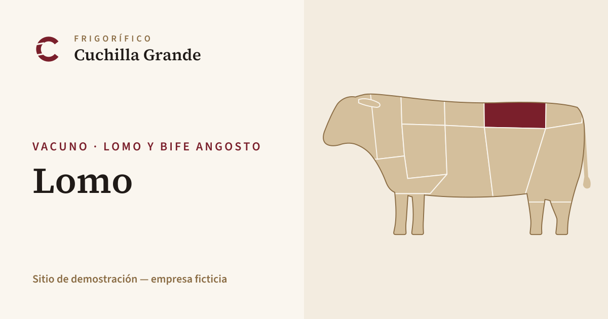
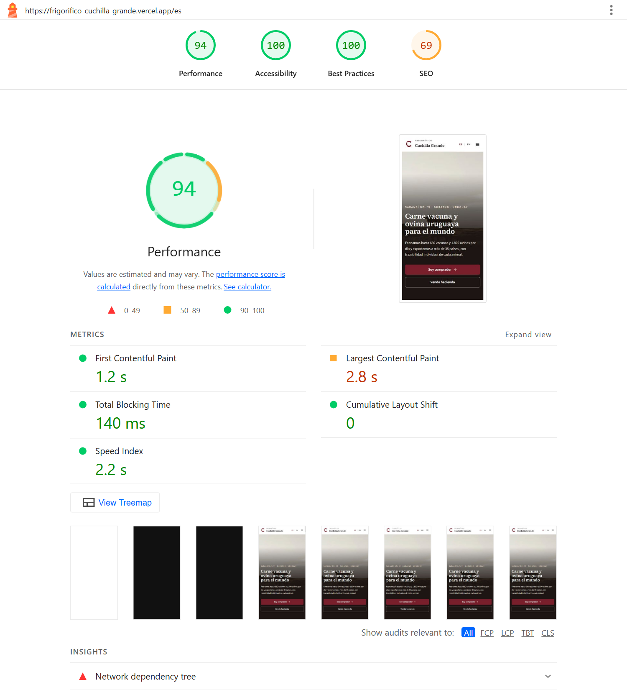
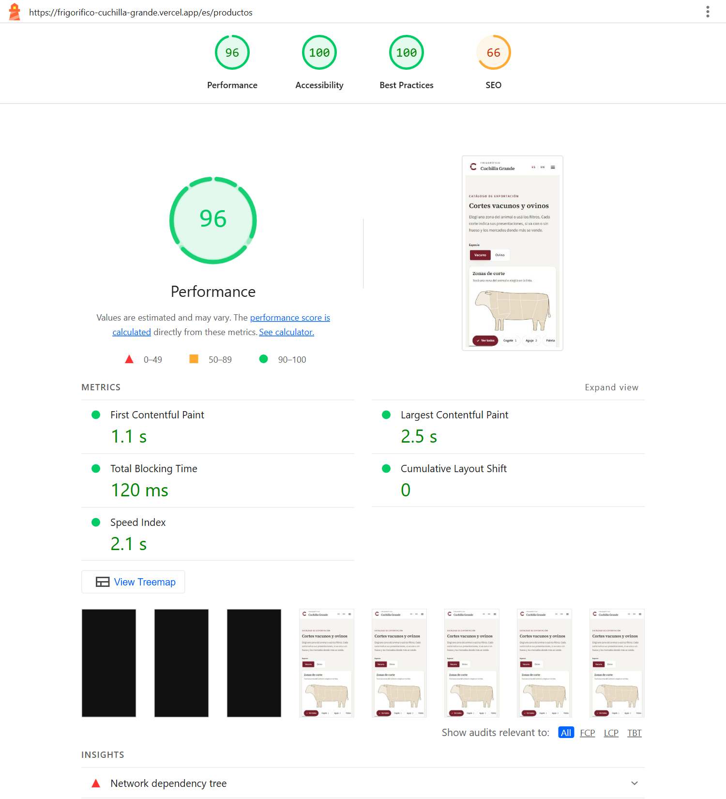
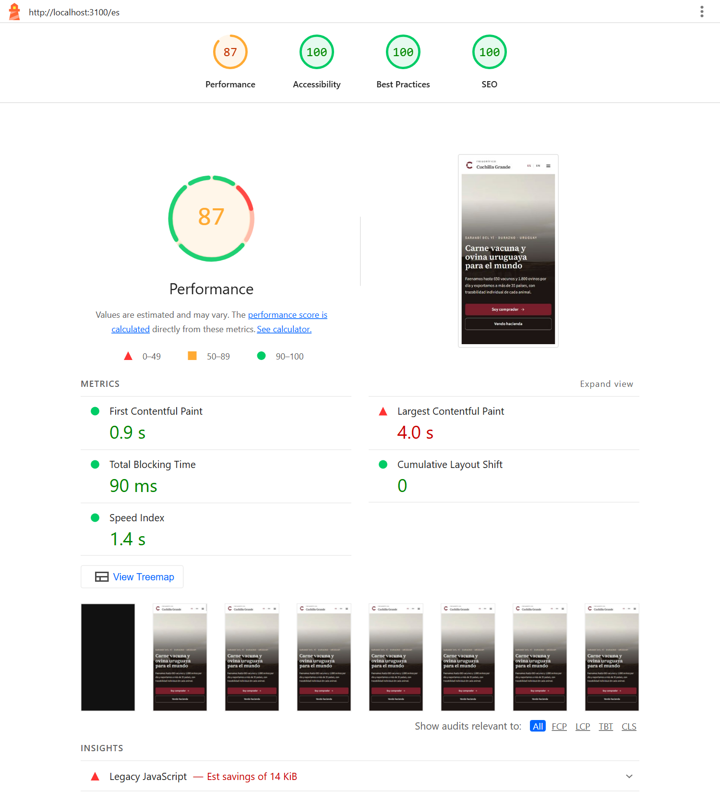

# QA — Frigorífico Cuchilla Grande (fase 6)

Informe de calidad del sitio de demostración: SEO técnico, accesibilidad, performance, seguridad,
operación y QA cruzado ES/EN. Medido el **16 de octubre de 2026** contra producción
(https://frigorifico-cuchilla-grande.vercel.app) salvo donde se indica.

Todo se puede repetir con los scripts del repo (ver `CLAUDE.md`, sección Comandos).

## Resumen

| Área | Resultado |
|---|---|
| Lighthouse móvil (12 mediciones) | Performance 93–98 · Accesibilidad 100 · Buenas prácticas 100 · SEO 66–69 por el noindex buscado; 100 en modo indexable |
| axe (100 combinaciones de página/estado × idioma × ancho) | 0 violaciones serias o críticas, 0 moderadas o menores |
| Recorrido por teclado | 62/62 verificaciones (formularios, diagrama, mapa, pestañas, menú, salto al contenido) |
| SEO técnico (`check:seo`) | 106 URLs del sitemap · 212 imágenes OG/Twitter · JSON-LD válido en todas |
| Códigos de estado | 404 desde el primer pedido para cortes, noticias y rutas inexistentes, en ES y EN |
| Headers de seguridad | CSP, nosniff, Referrer-Policy, Permissions-Policy, X-Frame-Options, COOP, HSTS |
| Claves en el bundle | Ninguna (búsqueda de los valores reales en `.next/static`) |
| QA existentes y enlaces | ver la tabla de abajo |

## Indexación (`SITE_INDEXABLE`)

La empresa es ficticia: por defecto el sitio **no se indexa**.

- `SITE_INDEXABLE` sin definir o `false` (producción): `<meta name="robots" content="noindex, nofollow">`
  en todas las páginas, `robots.txt` con `Disallow: /` y `X-Robots-Tag: noindex, nofollow` en todas
  las respuestas (también imágenes OG y sitemap).
- `SITE_INDEXABLE=true`: `index, follow`, `robots.txt` con `Allow: /` (salvo `/api/`) y sin X-Robots-Tag.
- El resto del SEO se genera igual en los dos modos.

Verificado en un deploy de preview con `SITE_INDEXABLE=true` (vía `vercel curl`, porque los previews
tienen Vercel Authentication): `robots.txt` permite el rastreo y las páginas llevan `index, follow`.
Vercel agrega su propio `X-Robots-Tag: noindex` a todos los previews, así que el SEO indexable se
midió con Lighthouse sobre un build local con `SITE_INDEXABLE=true` (tabla más abajo).

## SEO técnico

- **Metadata por página**: título con plantilla (`%s · Frigorífico Cuchilla Grande`; la home usa
  uno propio), descripción traducida, canonical, hreflang `es`, `en` y `x-default` con los slugs
  traducidos, Open Graph (`es_UY` / `en_GB`, `og:site_name`, `og:type` article en noticias) y
  Twitter card `summary_large_image`.
- **Imágenes OG** con `next/og`, tres plantillas de marca:
  - general (todas las páginas estáticas): bordó, antetítulo, título y bajada (PNG, 60–75 KB);
  - corte: silueta de la especie con la zona del corte resaltada (PNG, 65–75 KB);
  - noticia: foto, fecha y título (**JPEG, 68–99 KB**).

  Las de noticias pesaban 0,6–1,1 MB en PNG, porque el PNG guarda la foto sin compresión, y WhatsApp
  y otras redes no muestran la vista previa con imágenes tan pesadas. `ImageResponse` solo genera
  PNG: la plantilla de noticia recodifica el resultado en JPEG (sharp, calidad 80). Medido en
  producción en las 212 imágenes OG/Twitter: **máximo 97 KB**; `check:seo` falla si alguna
  supera 300 KB.

  | General | Corte | Noticia |
  |---|---|---|
  |  |  |  |
- **sitemap.xml**: 106 URLs (11 páginas estáticas, 36 cortes y 6 noticias, en ES y EN), cada una con
  sus alternates `es`, `en` y `x-default`.
- **JSON-LD**: `Organization` en todas las páginas (106), `BreadcrumbList` en cortes y noticias (84),
  `NewsArticle` en noticias (12). `check:seo` verifica que se puedan parsear y que tengan los campos
  obligatorios de cada tipo, y que el último ítem del breadcrumb sea la página.
- **hreflang recíproco**: para cada URL, la versión en el otro idioma apunta de vuelta (106/106).
- **Fechas por idioma**: ninguna fecha con formato estadounidense en inglés ni meses en inglés en
  español.
- `error.tsx` (dentro del layout, con next-intl) y `global-error.tsx` (reemplaza el documento; idioma
  según la URL) localizados.

### Códigos de estado (producción)

| Ruta | Código |
|---|---|
| `/es`, `/en` | 200 |
| `/es/productos/vacuno/lomo`, `/en/products/beef/tenderloin` | 200 |
| Noticia existente (ES y EN) | 200 |
| Corte inexistente (`/es/productos/vacuno/no-existe-…`, `/en/products/beef/no-such-…`) | **404** desde el primer pedido |
| Especie inexistente (`/es/productos/caballo/lomo`, `/en/products/horse/tenderloin`) | 404 |
| Noticia inexistente (ES y EN) | 404 |
| Ruta inexistente (`/es/no-existe-…`, `/en/nothing-…`) | 404 |
| `/` | 307 → `/es` (detección de idioma) |
| `/es/products` (ruta interna) | 307 → `/es/productos` |
| `/robots.txt`, `/sitemap.xml`, imágenes OG | 200 |
| `/api/cron/daily` sin secreto | 401 |

La limitación anotada en la fase 2 (el primer pedido a un corte inexistente devolvía 200) **ya no
ocurre en Vercel**: se probó con slugs nuevos en cada pedido. En `next start` local el primer pedido
todavía responde 200 con la página 404 y `noindex`; `qa:catalog` exige 404 solo contra un deploy.

## Accesibilidad

### axe (`npm run qa:a11y`)

axe-core 4.13 con las etiquetas WCAG 2.0/2.1/2.2 A y AA más buenas prácticas, en ES y EN, a 1440 y
375 px, sobre todos los tipos de página y estados interactivos:

- home, catálogo (y filtrado), corte con foto y sin foto, mercados (y con el panel de un mercado),
  calidad, empresa, productores (gráfico ovino con la tabla abierta, formulario con errores y con
  éxito), contacto (cotización con corte precargado, errores de cotización, pestaña de productores y
  sus errores), sostenibilidad (y otra pestaña), noticias, noticia, trabajá con nosotros,
  privacidad y 404;
- a 375 px también el menú móvil abierto y el panel de filtros del catálogo.

**Resultado: 0 violaciones serias o críticas y 0 moderadas o menores en las 100 combinaciones.**

Problemas que encontró la primera corrida y se corrigieron:

| Regla | Dónde | Corrección |
|---|---|---|
| `label-title-only` (serio) | Contacto, pestaña Productores | Los dos formularios repetían ids (`phone`, `message`, `privacy`, honeypot): las etiquetas apuntaban a los campos ocultos de la otra pestaña. Prefijo de ids por formulario (`FieldIdScope`). |
| `target-size` (serio) | Mercados: links de cortes y certificaciones | Links chicos apilados: alto mínimo de 24 px. |
| `scrollable-region-focusable` (serio) | Productores a 375 px: gráfico y tabla con scroll horizontal | Regiones enfocables con nombre (`tabIndex=0`, `role="region"`). |
| `landmark-unique` (moderado) | Menú móvil abierto | Dos `<nav aria-label="Idioma">` visibles: el del panel pasa a `role="group"`. |

### Teclado (`npm run qa:keyboard`)

62/62 verificaciones en ES y EN. En cada parada del Tab se comprueba que el foco sea **visible**
(algún estilo del elemento o de sus contenedores cambia entre enfocado y sin foco).

- Formularios (oferta de ganado, calculadora, cotización con selector de cortes, consulta de
  productores): el Tab recorre todos los controles visibles en orden del DOM, el honeypot nunca
  recibe foco, Espacio marca casillas y Enter envía, con el foco en el primer error.
- Selector de cortes: Enter en la búsqueda no envía el formulario, Tab y Espacio eligen un
  resultado y "Quitar" funciona con Enter.
- Diagrama: zonas enfocables y Enter selecciona (filtro en la URL).
- Mapa: mercados enfocables; Enter pasa al panel y Escape vuelve al mercado.
- Pestañas de contacto (en `qa:contact`) y de sostenibilidad: flechas, Inicio, Fin y Tab al panel.
- Menú móvil: Enter abre, el foco queda atrapado (30 Tab más Shift+Tab), Escape cierra y devuelve el
  foco al botón.
- Salto al contenido: es el primer Tab, es visible y Enter enfoca el `<main>`.

### Otros controles

- **`lang`**: el `<html lang>` coincide con el idioma de la URL en todas las combinaciones de axe y
  en las 106 URLs del sitemap.
- **Zoom al 200 %** (8 páginas): con zoom de página (1280 px → 640 px CSS) y con solo texto
  (tamaño de fuente del navegador a 32 px, como la configuración de Chrome): sin scroll horizontal y
  sin texto recortado.
- **prefers-reduced-motion**: sin transiciones, animaciones ni desplazamiento suave; los
  desplazamientos por JS ("Ofrecer este lote", mapa en móvil) piden `behavior: auto`. Sin la
  preferencia, `smooth`.
- **Contraste** (tokens de color, WCAG 2.1): todos los pares de texto de las fases 4 y 5 pasan AA.

| Texto / fondo | Uso | Contraste |
|---|---|---|
| ink-muted / surface | Ayudas de campos, pestañas inactivas | 7,82 |
| ink-muted / surface-muted | Aside de contacto, secciones alternadas | 7,18 |
| ink-muted / earth-50 | Método de sostenibilidad | 7,26 |
| brand-800 / surface | Pestaña activa | 12,45 |
| down / surface | Mensajes de error | 7,53 |
| brand-900 / brand-50 | Aviso de errores, chips de cortes | 13,63 |
| earth-800 / earth-100 | Badges de estado | 7,95 |
| earth-800 / earth-50 | Link a "Ofrecer ganado" | 8,66 |
| brand-100 / brand-800 | Caja de postulación | 10,08 |
| white / brand-700 | Botón primario | 10,20 |
| brand-700 / earth-50 | Links en cajas tierra | 9,47 |
| ink-subtle / surface | Placeholder de la búsqueda | 5,48 |

`earth-600` (4,48:1) solo se usa en elementos que no son texto (barras de avance, mapa), donde el
mínimo es 3:1.

## Performance

### Lighthouse móvil — producción (noindex)

Lighthouse 13.5 con la simulación móvil por defecto (Moto G Power, 4G lenta, CPU ×4).

| Página | Idioma | Performance | Accesibilidad | Buenas prácticas | SEO | LCP | CLS | TBT | JS (KB) |
|---|---|---|---|---|---|---|---|---|---|
| Home | es | 94 | 100 | 100 | 69 | 2,8 s | 0 | 140 ms | 194 |
| Home | en | 93 | 100 | 100 | 69 | 3,2 s | 0 | 90 ms | 194 |
| Catálogo | es | 96 | 100 | 100 | 66 | 2,5 s | 0 | 120 ms | 187 |
| Catálogo | en | 97 | 100 | 100 | 66 | 2,5 s | 0 | 100 ms | 187 |
| Detalle de corte | es | 94 | 100 | 100 | 69 | 2,9 s | 0 | 130 ms | 186 |
| Detalle de corte | en | 94 | 100 | 100 | 69 | 2,9 s | 0 | 120 ms | 187 |
| Mercados | es | 95 | 100 | 100 | 66 | 2,7 s | 0 | 160 ms | 172 |
| Mercados | en | 95 | 100 | 100 | 66 | 2,5 s | 0 | 160 ms | 172 |
| Productores | es | 95 | 100 | 100 | 66 | 2,4 s | 0 | 190 ms | 178 |
| Productores | en | 95 | 100 | 100 | 66 | 2,4 s | 0 | 200 ms | 178 |
| Contacto | es | 98 | 100 | 100 | 66 | 2,3 s | 0 | 90 ms | 178 |
| Contacto | en | 98 | 100 | 100 | 66 | 2,3 s | 0 | 80 ms | 178 |

**SEO** marca solo `is-crawlable` ("la página está bloqueada para la indexación"): es el noindex
buscado. La diferencia entre 66 y 69 es el peso de esa auditoría según las demás que aplican.

### Lighthouse móvil — modo indexable (`SITE_INDEXABLE=true`, build local)

SEO 100 en las 12 mediciones; Accesibilidad y Buenas prácticas 100. Performance 87–92: el servidor
local no tiene CDN ni HTTP/2, por eso los valores de referencia son los de producción.

| Página | es | en |
|---|---|---|
| Home | SEO 100 · P 87 | SEO 100 · P 87 |
| Catálogo | SEO 100 · P 91 | SEO 100 · P 89 |
| Detalle de corte | SEO 100 · P 90 | SEO 100 · P 90 |
| Mercados | SEO 100 · P 89 | SEO 100 · P 89 |
| Productores | SEO 100 · P 92 | SEO 100 · P 91 |
| Contacto | SEO 100 · P 91 | SEO 100 · P 90 |

| Home (móvil, producción) | Catálogo (móvil, producción) | Home en modo indexable |
|---|---|---|
|  |  |  |

Informes completos (JSON y HTML) con `npm run lighthouse`, en `screenshots/lighthouse/<label>/`
(no versionado).

### JavaScript, fuentes e imágenes

- **JS por ruta** (comprimido, navegadores modernos): unos 150 KB, casi todo el runtime: React DOM
  (71 KB), el router de Next (47 KB), el parser ICU de next-intl (15 KB) y unos 15 KB de código propio.
  Los polyfills (38 KB) van con `noModule` y los navegadores modernos no los descargan.
- **d3-geo, topojson-client, world-atlas y los datos de los mapas no llegan al cliente**: los dos
  mapas (mercados y ubicación) se proyectan en el servidor; se buscó en los chunks de `.next/static`.
- Se corrigieron dos cargas innecesarias:
  - `global-error` importaba los dos archivos de mensajes completos (unos 70 KB sin comprimir en
    todas las páginas): ahora usa un módulo chico propio;
  - el proveedor de next-intl mandaba al navegador los mensajes de todo el sitio: ahora solo los
    namespaces que usan los componentes de cliente (unos 7 KB comprimidos menos de HTML por página).
- **CLS 0** en todas las páginas.
- **Fuentes**: Source Serif 4 y Source Sans 3 autohospedadas con `next/font` (`display: swap`). La
  serif se usa solo en semibold: un archivo estático de 600 (21 KB) en lugar del variable (51 KB).
  La sans queda variable (29 KB).
- **Imágenes**: `next/image` con `sizes` reales. Lighthouse sugiere 107 KB de ahorro en las fotos de
  la home, pero el navegador ya elige el ancho correcto (380 px × DPR 1,75 → 750 px del srcset).
- **Mercados** es la página más pesada en HTML (unos 107 KB comprimidos) por las rutas del SVG del
  mapa, que van en el HTML y en el payload RSC. Igual mide Performance 95.

### LCP

En la medición de la fase 6 tenían LCP > 2,5 s la home (2,8 / 3,2 s), el detalle de corte (2,9 s) y
mercados (2,7 / 2,5 s). Desglose (Lighthouse, fases observadas):

| Página | Elemento LCP | Qué demoraba |
|---|---|---|
| Home | Foto del hero (40 KB, variante vertical en móvil) | ~350 ms hasta que empieza a bajar y ~600 ms de render después de bajada |
| Detalle de corte | Foto de la pieza | ~380 ms hasta que empieza a bajar y ~500–900 ms de render |
| Mercados, catálogo | Bajada del encabezado (texto) | ~850 ms de render, sin red de por medio |

Qué se hizo:

- **Fuentes**: la serif pasó de variable (51 KB) a estática de 600 (21 KB); son 30 KB menos en la
  ruta crítica de todas las páginas.
- **Detalles de corte y de noticia**: `preload` en la foto (`<link rel="preload">` con `imagesrcset`
  en el `<head>`). Se verificó que no se filtra: el catálogo y el listado de noticias no descargan
  las fotos de los detalles.
- **Hero de la home**: se probó precargar las dos variantes con `preload()` de React y `media`, y
  la demora previa a la descarga bajó de ~350 ms a ~50 ms. **Se revirtió**: la sugerencia viaja
  en el payload RSC y, como las demás páginas precargan la home (logo, "Inicio"), catálogo,
  contacto y productores descargaban la foto del hero con prioridad alta (40 KB extra en cada página).
- **Imágenes**: los `sizes` ya eligen el ancho correcto y las fotos LCP pesan unos 40 KB; no hay
  margen ahí.

Lo que no se pudo bajar más, y por qué:

- El tramo dominante es el **render tardío** (500–900 ms observados), no la red: el navegador pinta
  el elemento LCP después de evaluar el JavaScript de arranque de Next y React (unos 150 KB
  comprimidos), y la simulación móvil de Lighthouse lo multiplica por la CPU ×4. Reducirlo exigiría
  sacar JS del runtime (React, router de Next), que no depende del sitio.
- En las páginas con LCP de texto, `font-display: optional` evitaría que el cambio de fuente cuente
  como LCP, pero en la primera visita con red lenta el sitio se vería con la fuente de reemplazo. Se
  priorizó la identidad tipográfica.
- Hay ruido entre corridas: el mismo detalle de corte midió 2,5 s en ES y 2,8 s en EN en la misma
  tanda.

Resultado de la última medición (tabla de arriba): ver el resumen al final de esta sección.

## Seguridad

### Headers (todas las respuestas)

| Header | Valor |
|---|---|
| Content-Security-Policy | `default-src 'self'; script-src 'self' 'unsafe-inline'; style-src 'self' 'unsafe-inline'; img-src 'self' data: blob:; font-src 'self'; connect-src 'self'; frame-ancestors 'none'; base-uri 'self'; form-action 'self'; object-src 'none'; upgrade-insecure-requests` |
| X-Content-Type-Options | `nosniff` |
| Referrer-Policy | `strict-origin-when-cross-origin` |
| Permissions-Policy | `camera=(), microphone=(), geolocation=(), payment=(), usb=(), browsing-topics=()` |
| X-Frame-Options | `DENY` (más `frame-ancestors 'none'` en la CSP) |
| Cross-Origin-Opener-Policy | `same-origin` |
| Strict-Transport-Security | `max-age=63072000; includeSubDomains; preload` (Vercel) |
| X-Robots-Tag | `noindex, nofollow` (mientras `SITE_INDEXABLE` no sea `true`) |
| X-Powered-By | eliminado (`poweredByHeader: false`) |

### CSP: por qué no es estricta

La CSP aplicada no permite ningún origen externo (fuentes e imágenes propias; el navegador nunca habla
con Supabase), ni `eval`, ni ser embebida en frames. Lo que no puede evitar es `'unsafe-inline'` en
scripts: Next inyecta scripts inline (arranque y payload RSC) en las páginas **estáticas**. La
alternativa estricta (nonce por pedido) obliga a renderizar cada página en cada visita, y se pierden
el prerender, la caché del CDN y PPR.

La versión estricta (sin `'unsafe-inline'`) se probó en modo **report-only**: Chrome registra un
error de consola y un aviso de DevTools por cada script inline, y eso bajó "Buenas prácticas" a 92.
Por eso queda detrás de `CSP_STRICT_REPORT_ONLY=true`, para auditar, y apagada en producción.

### Claves

Se buscaron los **valores reales** de `SUPABASE_SECRET_KEY`, `SUPABASE_PUBLISHABLE_KEY`,
`CRON_SECRET`, `IP_HASH_SALT` y `SUPABASE_DB_URL` (leídos de `.env.local`, sin imprimirlos) en todo
`.next/static`, más los patrones `sb_secret_`, `service_role`, `SUPABASE_SECRET` y `CRON_SECRET`:
**0 coincidencias**. Ninguna variable de Supabase lleva prefijo `NEXT_PUBLIC_`.

## Operación

- **Cron**: habilitado en Vercel (`/api/cron/daily`, `0 9 * * *`). Vercel Hobby retiene los logs
  menos de una hora (la CLI y el panel no permiten consultar más atrás) y los logs de pedidos del CDN
  requieren Observability Plus. En los logs de API de Supabase (24 horas en el plan gratuito) consta
  la ejecución programada del **16 de octubre a las 09:25 UTC** (06:25 en Montevideo, dentro de la
  ventana de una hora de Hobby): `GET price_quotes` y el `DELETE` de purga. Las corridas anteriores
  ya no están en ningún log.
- Para que esto se pueda verificar en adelante, desde la fase 6 cada ejecución queda registrada en
  la tabla `cron_runs` (sin permisos para anon) y `npm run ops:status` muestra el historial y avisa si
  falta algún día. Primera fila: 16 de octubre a las 18:58 UTC (ejecución manual de verificación).
- **Rotación del lunes 19 de octubre — verificación pendiente.** Al cerrar el proyecto (16 de
  octubre) todavía no ocurrió. El lunes 19 de octubre de 2026, después de las 10:00 UTC (07:00 en
  Montevideo), correr:

  ```
  npm run ops:status
  ```

  y confirmar que figura una ejecución del 19 con `semana 2026-10-19 · 6 precios` y que pasa
  "pizarra: semana vigente (2026-10-19) cargada". En la fase 5 ya se verificó en producción que el
  cron inserta la semana con la fórmula nueva (borrando la vigente y llamándolo a mano).
- **Supabase**: el proyecto figura **Healthy** y sin aviso de pausa (panel del proyecto, 16 de octubre). El cron
  diario lo mantiene activo.

## QA cruzado ES/EN

- **Paridad**: `i18n:check` verifica las mismas claves en los dos idiomas, sin vacíos ni textos
  copiados del español (604 mensajes y 222 campos de contenido). Además se compararon largos y
  oraciones de los 806 pares de textos; las noticias tienen los mismos párrafos en los dos idiomas.
- **Formatos**: cifras con separador de miles siempre (`formatFigure`). Las fechas en inglés salían
  en formato estadounidense ("October 12, 2026"): ahora todas pasan por `formatDate` con `en-GB`
  ("12 October 2026"). `check:seo` lo verifica en las 106 URLs.
- **Voseo**: no hay formas de tuteo ni de usted en los textos en español.
- **Inglés británico**: quedaban "catalog" (dos mensajes y una noticia) y "U.S.": ahora "catalogue" y
  "US", como en el resto del sitio (centre, flavour, programme, recognised, tonnes, travelled).
- **Sin textos sin traducir**: ESLint prohíbe texto literal en JSX y en `alt`, `title`,
  `placeholder` y `aria-label`; `i18n:check` sin problemas.

## QA existentes y enlaces (producción)

| Prueba | Qué verifica | Resultado |
|---|---|---|
| `check:links` | Links internos y anclas (también entre páginas), soft-404, mailto de cotización | 200 URLs y 234 anclas sin errores; ningún mailto de cotización (280 revisados); 1.024 links "Pedir cotización" a /contacto |
| `check:seo` | Metadata, hreflang, robots, OG/Twitter, JSON-LD, fechas por idioma | 106 URLs, 212 imágenes, sin errores |
| `qa:layout` | Salto al contenido, menú móvil, idioma, imágenes, overflow | 20/20 |
| `qa:catalog` | Diagrama por teclado, filtros en la URL, detalle, 404 desde el primer pedido | 42/42 |
| `qa:institutional` | Mapa = lista, links al catálogo filtrado, panel por teclado, CLS, 375 px | 82/82 |
| `qa:fixes` | Menú a 375×667, catálogo móvil, drawer, foto de origen | 40/40 |
| `qa:producers` | Pizarra ordenada y fórmula (12 semanas), calculadora, precarga, validación, honeypot, errores a 375 px | 78/78 |
| `qa:contact` | Pestañas, precarga del corte (ES/EN), validaciones, honeypot, errores a 375 px | 70/70 |
| `qa:a11y` | axe, lang, zoom 200 %, movimiento reducido | 100 combinaciones, 0 violaciones; 19/19 verificaciones extra |
| `qa:keyboard` | Recorrido completo por teclado | 62/62 |
| `db:test-permissions` | RLS y grants con la clave publicable (incluye `cron_runs`) | OK |
| `ops:status` | Ejecuciones del cron, pizarra, purga | OK |
| typecheck, lint, build, i18n:check | — | OK |

## Pendientes

| Pendiente | Motivo |
|---|---|
| Confirmar la rotación automática del lunes 19 de octubre de 2026 | Todavía no ocurrió al cierre. Comando: `npm run ops:status` después de las 10:00 UTC del 19. |
| Historial del cron anterior al 16 de octubre | Vercel Hobby y Supabase gratis ya no conservan esos logs; desde la fase 6 queda en `cron_runs`. |
| CSP sin `'unsafe-inline'` en scripts | Requiere nonce por pedido y renderizar todas las páginas en cada visita (sin prerender ni CDN). |
| Imágenes OG prerenderizadas | Con Cache Components se generan en el primer pedido y después las sirve el CDN (caché de un año). |
| LCP ≤ 2,5 s en todas las páginas | El tramo que queda es el render tardío por el JS de arranque de React y Next (ver "LCP"). |
| SEO 100 medido sobre un deploy de Vercel | Los previews tienen Vercel Authentication y `X-Robots-Tag: noindex` propio de Vercel; se midió con el mismo build en local. |
